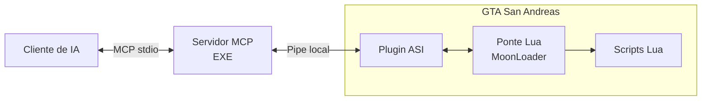

# GroveMCP — versão 0.3.0

O GroveMCP conecta agentes de IA ao GTA San Andreas para ajudar a criar mods,
experimentar ideias e investigar o comportamento do jogo enquanto ele está aberto.
Você descreve o que quer fazer, e o agente pode escrever e executar scripts Lua,
consultar informações do jogo e usar os resultados para orientar o próximo passo.

Isso permite, por exemplo, pedir um texto na tela, criar um NPC ou consultar a
vida de um personagem. Para depuração, os scripts também podem coletar dados ao
longo do tempo e devolver resultados e erros ao agente.

A integração com o jogo roda localmente no Windows e usa MoonLoader para executar
os scripts. O MCP é o protocolo que permite ao agente acessar essas ferramentas.
Veja a [configuração no Codex e no Claude Code](docs/CLIENTS.md) para conectar seu
cliente; o [chat dentro do jogo](docs/INGAME_CHAT.md) é um complemento opcional
específico do Codex.

## Demonstração

https://github.com/user-attachments/assets/dd2141de-b42b-4669-b241-fad09c827571

Um exemplo de execução de script Lua pelo GroveMCP para mostrar um texto na tela
com o GTA em execução.

## Como funciona

O agente acessa o servidor pelo cliente de IA. O servidor encaminha os pedidos
ao plugin instalado no GTA, e a ponte Lua os recebe para executar os scripts
pelo MoonLoader. Estados da execução, resultados e erros voltam pelo mesmo caminho.



O EXE é um processo separado e pode ser reiniciado sem fechar o GTA. O ASI e a
ponte Lua permanecem no jogo. Scripts convencionais são carregados pelo MoonLoader;
a execução gerenciada acrescenta acompanhamento, retorno de dados em JSON e
cancelamento pelo MCP.

A ponte `mcp_bridge.lua` consulta a fila do ASI por funções exportadas. Os dados
e erros dos scripts gerenciados retornam ao cliente por essa mesma ponte.

## Documentação

Referência offline para escrever e depurar scripts:
[docs/moonloader/README.md](docs/moonloader/README.md). Inclui o guia salvo do
GTAForums, funções/opcodes, eventos, páginas da wiki e pesquisa local, sem rede.

Chat experimental dentro do jogo: [docs/INGAME_CHAT.md](docs/INGAME_CHAT.md).
F7 abre um painel MoonImGui conectado a uma sessão própria do Codex CLI, com
acesso ao MCP do GTA e respostas no painel.

Referência de memória e skill para funções/classes/offsets:
[docs/game-memory/README.md](docs/game-memory/README.md).

Configuração portátil, arquivos ignorados e testes:
[docs/REPOSITORY.md](docs/REPOSITORY.md).

Configuração no Codex e no Claude Code, com estado de validação e teste mínimo:
[docs/CLIENTS.md](docs/CLIENTS.md). O núcleo MCP é independente do cliente;
o chat F7 continua sendo uma integração experimental específica do Codex.

## Pacotes da release

Os pacotes publicados ficam na página [Releases do GroveMCP](https://github.com/Joaom-eng/GroveMCP/releases).
Clone este repositório para uma pasta fixa: ele já inclui o servidor compilado
em `bin/Host/Release/McpServer.exe`, as ferramentas e a documentação da IA.
Não é necessário compilar para usar o projeto.

Os ZIPs da release contêm somente os componentes instalados no GTA. Com o jogo
fechado, extraia o pacote principal na raiz do GTA, mantendo a estrutura das
pastas. Ele contém o ASI e a ponte Lua. O chat experimental do Codex é um ZIP
opcional para extrair no mesmo local; seu relay Python permanece no repositório.
Veja [docs/INGAME_CHAT.md](docs/INGAME_CHAT.md) para ativá-lo.
Para quem mantém o projeto e precisa gerar os arquivos para publicação, veja
[docs/RELEASE.md](docs/RELEASE.md).

## Compilar

Esta etapa é opcional, para quem deseja alterar o código. O EXE já vem compilado
no repositório, e o ASI compilado está no pacote principal da release.

Abra `McpServer.sln`, **Release / GTA-SA**, com toolset v143 e Windows SDK.
O ASI usa `PLUGIN_SDK_DIR`. O projeto `Host` não depende do Plugin-SDK para compilar.

```powershell
msbuild .\McpServer.sln /p:Configuration=Release /p:Platform=GTA-SA /p:DeployToGame=false /m
```

Saídas Win32: `bin/GTA-SA/Release/McpServer.SA.asi` e `bin/Host/Release/McpServer.exe`.
O post-build original só roda com `DeployToGame=true`: ele encerra o GTA e copia
o ASI para `scripts`. Compilar normalmente não encerra nem instala nada no jogo.

## Instalar e testar

1. Feche o GTA antes de substituir o ASI.
2. Com ASI Loader e MoonLoader instalados, extraia o pacote principal da release
   na raiz do GTA. Ele coloca `McpServer.SA.asi` na raiz, `mcp_bridge.lua` em
   `moonloader` e `mcp_runner.lua` em `moonloader/lib`.
3. Se preferir instalar o ASI numa pasta do Modloader, mova-o para lá e mantenha
   **uma única cópia**. O EXE permanece no repositório, fora da pasta do jogo.

O exemplo `moonloader/examples/mcp_hello.lua` apenas escreve no log e espera um
segundo. Coloque-o fora da varredura automática do MoonLoader, por exemplo em
`GTA San Andreas/mcp_scripts/mcp_hello.lua`.

```powershell
& '.\bin\Host\Release\McpServer.exe' --probe
```

Esperado: `connected: true` (conexão com o ASI), `moonloader_worker_ready: true`
(script de comunicação do MoonLoader disponível), `simulated: false` (ponte
real, não a simulada dos testes) e `bridge_protocol: 3` (versão do protocolo
interno entre EXE e ASI). Veja a explicação em [docs/CLIENTS.md](docs/CLIENTS.md).
Confira a mensagem `MCP Bridge: v3 ready` em `moonloader.log`.

**EXE, ASI e script Lua precisam ser da mesma versão.** Esta versão muda o pipe
para `\\.\pipe\McpServer.GtaSa.v3` e o pacote binário para 17980 bytes. Substitua o
ASI antigo com o jogo fechado. Não deixe cópias duplicadas na raiz e em `scripts`.

O EXE conecta a cada requisição e pode ser reiniciado sem fechar o GTA. O pipe
atende um cliente por vez. Menu, pausa ou carregamento podem interromper o
processamento da ponte e causar timeout (1,5 segundo). O worker usa
`script_properties('work-in-pause')` para continuar processando durante a pausa
quando o MoonLoader mantém seu ciclo ativo; isso não faz o GTA continuar
simulando o mundo quando está pausado.

## Codex e MCP

Configure a entrada `gta_sa` no cliente, substituindo o caminho de exemplo pelo
EXE pronto em `bin/Host/Release/McpServer.exe` da sua cópia do repositório:

```toml
[mcp_servers.gta_sa]
command = 'C:\path\to\McpServer\bin\Host\Release\McpServer.exe'
args = ["--stdio"]
```

Recarregue o cliente se as ferramentas ainda não aparecerem. O cliente inicia o
EXE automaticamente. As políticas de aprovação existentes não foram alteradas.
O servidor negocia **MCP 2025-11-25**; não implementa a revisão 2026-07-28.

| Ferramenta | Entrada | Resultado |
|---|---|---|
| `gta_get_status` | `{}` | Conexão, PID, ticks, uptime e disponibilidade do worker |
| `gta_load_script` | `{"path":"C:\\...\\example.lua"}` | Pedido enfileirado e `command_id` |
| `gta_run_script` | `{"path":"C:\\...\\probe.lua","params":{},"timeout_ms":30000}` | Execução gerenciada, retorna `command_id` |
| `gta_get_command` | `{"command_id":1}` | Estado e último resultado JSON ou erro da execução |
| `gta_stop_script` | `{"command_id":1}` | Solicita cancelamento de uma execução gerenciada |

`loaded` confirma que `script.load` retornou um objeto; **não confirma que a lógica
terminou nem que não falhará depois**. Consulte o log para a execução posterior.
O arquivo deve existir, ter caminho absoluto e extensão `.lua`. O MCP usa UTF-8;
o ASI converte o caminho para a página ANSI do Windows para o MoonLoader e rejeita
caracteres não representáveis em vez de substituí-los silenciosamente.

Não repetir automaticamente `gta_load_script` ou `gta_run_script` após timeout: o pedido pode já ter
sido aceito. Não há deduplicação de carregamentos por arquivo nesta versão.

Cliente diagnóstico sem IA, com Python 3:

```powershell
python .\tools\mcp_client.py
python .\tools\mcp_client.py --load (Resolve-Path .\moonloader\examples\mcp_hello.lua).Path
python .\tools\mcp_client.py --wait-ready 40 --load (Resolve-Path .\moonloader\examples\mcp_hello.lua).Path
```

Ele faz handshake, lista ferramentas, consulta estado e, se solicitado, enfileira
o arquivo uma vez e acompanha o resultado por até cinco segundos.

## Fila e exports

- `McpBridge_GetApiVersion()`: versão 3.
- `McpBridge_PollCommand(output, size)`: 1 com comando, 0 vazia, -1 ABI inválida.
- `McpBridge_ReportResult(id, success, scriptId, message)`: confirma carregamento.
- `McpBridge_ReportExecution(id, state, scriptId, json, length)`: publica estado
  e JSON UTF-8, até 16383 bytes, sem truncamento silencioso.

O Lua localiza o ASI já carregado por `GetModuleHandleA`/`GetProcAddress`.
Os nomes exportados não têm decoração C++. O worker consulta a fila a cada 50 ms.
O ASI reconhece o worker por dois segundos após a última consulta e rejeita novos
pedidos se ele estiver ausente.

FIFO com até 64 pedidos pendentes e histórico de 256 pedidos, sob mutex. Pedidos
ainda não retirados expiram após 30 segundos. O histórico reside no ASI e sobrevive
ao reinício do EXE, mas não ao reinício do jogo. Comandos retirados não são
reenviados se o worker falhar; podem permanecer `loading`, sem confirmação.

I/O no ASI usa `PIPE_NOWAIT` e trabalho limitado por ciclo. O cliente trata pacotes
parciais, usa overlapped I/O com timeout e espera o cancelamento antes de liberar
buffers. Clientes remotos do pipe são rejeitados.

## Testes

Os testes abaixo fazem parte do código-fonte e não são incluídos nos ZIPs da release.

```powershell
python .\tests\integration.py
msbuild .\tests\QueueTests.vcxproj /p:Configuration=Release /p:Platform=Win32
& '.\bin\Tests\QueueTests.exe'
```

Integração: pipe exclusivo e worker **simulado**, sem execução de Lua. Verifica
MCP, reconexão, fragmentação, timeout, carga aceita/recusada, worker ausente e
validação de caminhos/IDs. Testes C++ verificam FIFO, limites, transições e
rejeição de confirmações duplicadas. Sintaxe e ABI foram conferidas no LuaJIT.
Esses testes não substituem o carregamento real dentro do GTA.

### Execução gerenciada e retorno Lua → MCP

Arquivos usados com `gta_run_script` devem retornar uma função. Eles rodam em um
estado Lua separado, com as funções do MoonLoader disponíveis, e recebem `ctx`:

```lua
return function(ctx)
    ctx.publish({phase = 'sampling'}) -- snapshot consultável enquanto está running
    wait(ctx.params.delay_ms or 250)
    return {health = getCharHealth(PLAYER_PED)} -- resultado final
end
```

Consulte `gta_get_command` com o ID retornado. Estados gerenciados:
`queued → loading → running → completed/failed`; cancelamento passa por
`cancelling → cancelled` quando o runner é descarregado. Cancelar um pedido ainda
na fila impede sua execução. Estados terminais não aceitam atualizações tardias.

O campo `result` contém o último snapshot ou resultado final (inclusive `null`).
Erros em `loadfile`, no corpo do módulo, na função retornada ou na serialização
produzem `failed`, `isError:true` e `execution_error`. Erros Lua incluem mensagem
e traceback; erros de infraestrutura incluem `kind` e mensagem. `ctx.params`
recebe o objeto JSON informado no pedido. `ctx.command_id` identifica a execução.

`timeout_ms` é de 100 a 300000, padrão 30000, contado após o início da execução,
sem incluir tempo de espera na fila. O worker encerra runners suspensos em wait;
um instruction hook interrompe loops Lua. O JIT do runner é desativado para o
hook funcionar inclusive em funções carregadas depois. Não há preempção de
chamadas nativas/FFI bloqueadas, nem isolamento de memória do GTA.

O retorno é pela API C do ASI e pelo pipe, sem ler arquivos de resultado. O
worker cria apenas wrappers temporários em `moonloader/mcp_runtime` e os remove
quando observa o término. `mcp_runner.lua` fica em `lib` para não ser iniciado
automaticamente como um script comum. Recarregar o worker encerra os runners
que ele acompanha. Cancelamento não desfaz alterações feitas no mundo do jogo.

Use `gta_load_script` para scripts MoonLoader convencionais com `main()` e
callbacks próprios. O runner gerenciado captura a execução do módulo/função,
não callbacks assíncronos ou corrotinas adicionais criados pelo usuário.
`ctx.publish` guarda somente o snapshot mais recente; não é uma fila de eventos.
O histórico e os resultados ficam no ASI e sobrevivem ao reinício do EXE.

Exemplo pronto: `moonloader/examples/mcp_debug_probe.lua`.

```powershell
python .\tools\mcp_client.py --run (Resolve-Path .\moonloader\examples\mcp_debug_probe.lua).Path --params '{"samples":3,"interval_ms":250}'
python .\tools\mcp_client.py --command 1
python .\tools\mcp_client.py --stop 1
```

Testes adicionais:

```powershell
& "$env:GTA_SA_DIR\moonloader\luajit\bin\luajit.exe" .\tests\RunnerTests.lua .\moonloader\lib\mcp_runner.lua
python .\tests\live_execution.py --output .\.local\test-results\runtime_live_result.json
```

O primeiro executa o runner real no LuaJIT com fronteiras MoonLoader/ASI simuladas.
O segundo deve ser iniciado explicitamente e precisa do GTA aberto, com o CJ
disponível para controle e a versão 3 instalada.
Usa o exemplo `moonloader/examples/mcp_execution_test.lua` desta cópia do projeto,
ou outro caminho absoluto informado em `--script`. Consulta a vida do CJ, testa JSON com
acentos, traceback antes/depois de wait, snapshots, cancelamento, timeout de
espera/loop, retorno nulo e rejeição de resultado grande. Não modifica o jogador.

### Cobertura dos testes

Os testes locais verificam comunicação MCP/IPC, fila de comandos e comportamento
do executor Lua. O teste com o GTA verifica leitura da vida do CJ, retorno JSON
com acentos, erros antes e depois de `wait`, resultados parciais, cancelamento,
tempo limite, retorno nulo e rejeição de resultados acima do limite de tamanho.

O ambiente de referência é GTA SA PC 1.0 US com MoonLoader 0.27.0-preview3.
Consulte [docs/CLIENTS.md](docs/CLIENTS.md) para a compatibilidade por cliente e
[docs/REPOSITORY.md](docs/REPOSITORY.md) para os comandos de teste.
Relatórios específicos da máquina e da execução ficam em `.local/test-results`,
fora do Git.

## Referências

- [MCP stdio](https://modelcontextprotocol.io/specification/2025-11-25/basic/transports)
- [MCP lifecycle](https://modelcontextprotocol.io/specification/2025-11-25/basic/lifecycle)
- [MCP tools](https://modelcontextprotocol.io/specification/2025-11-25/server/tools)
- [MoonLoader API por FYP](https://gist.github.com/THE-FYP/abc6f8bea87f4cb42331fc6dd7a84576)
- [LuaJIT FFI](https://luajit.org/ext_ffi_api.html)
- [Configuração MCP no Codex](https://learn.chatgpt.com/docs/extend/mcp?surface=cli)

GroveMCP: licença MIT em [LICENSE](LICENSE).
Créditos e licenças de terceiros: [THIRD_PARTY_NOTICES.md](THIRD_PARTY_NOTICES.md).
